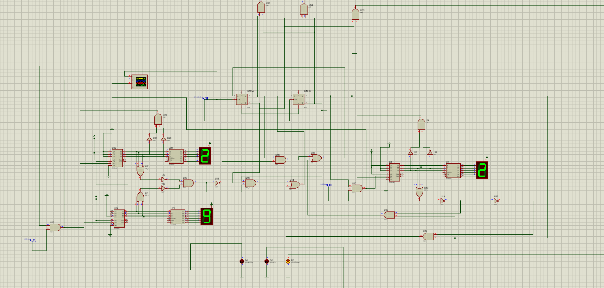
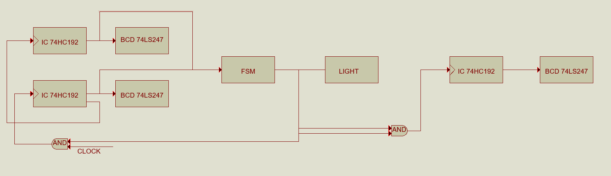
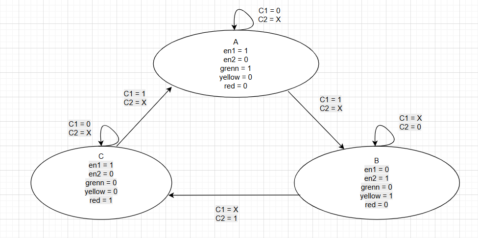

# Traffic Light Controller

**Thái Trung Sinh** · Digital Logic · FSM · Proteus

[Tiếng Việt](README.vi.md) · [Design notes](docs/design.md) · [Project slides](docs/technical-slides.pdf) · [Proteus circuit](proteus/TrafficLight.pdsprj)

This is a university group project on a traffic light controller with a countdown display. I worked on the state table, FSM logic, Karnaugh-map simplification, BCD countdown circuit and Proteus simulation.

## My work

- Built the state table for the green, yellow and red phases.
- Designed a three-state FSM and simplified the control logic using Karnaugh maps.
- Connected 74192 BCD down counters to seven-segment displays.
- Designed and simulated the controller circuit in Proteus.

The circuit and presentation belong to the group project. The work listed above is my contribution.

## Circuit

*Circuit image from our project presentation.*

The controller follows **Green → Yellow → Red → Green**. Two 74192 counters form the two-digit countdown for the green and red phases. A third counter handles the yellow phase. The FSM selects the active counter branch and the light outputs.

| Component | Use in the circuit |
| --- | --- |
| 74192 | BCD countdown |
| 74LS247 | BCD-to-seven-segment decoding |
| Seven-segment display | Countdown display |
| 4013 flip-flops | FSM state storage |
| Logic gates | Next-state logic, enable signals and light outputs |

## FSM

I used three states: A for green, B for yellow and C for red. The state bits are written in the order `s0 s1`.

- `C1 = 1`: the green/red countdown has finished.
- `C2 = 1`: the yellow countdown has finished.
- `en1`: enables the green/red countdown branch.
- `en2`: enables the yellow countdown branch.

| State | Code | Light | `en1` | `en2` | Next state |
| --- | --- | --- | --- | --- | --- |
| A | `00` | Green | 1 | 0 | A while `C1=0`; B when `C1=1` |
| B | `01` | Yellow | 0 | 1 | B while `C2=0`; C when `C2=1` |
| C | `10` | Red | 1 | 0 | C while `C1=0`; A when `C1=1` |

The [design notes](docs/design.md) include the full state table, Karnaugh maps and simplified equations.

## Run in Proteus

1. Download or clone this repository.
2. Open [`TrafficLight.pdsprj`](proteus/TrafficLight.pdsprj) in Proteus.
3. Check the clock sources, counter presets and initial FSM state.
4. Run the circuit and observe the countdown displays and light transitions.

Phase timing depends on the clock and preset values in the circuit. The images in this repository are from the project slides.

## Files

| Path | Content |
| --- | --- |
| [`proteus/TrafficLight.pdsprj`](proteus/TrafficLight.pdsprj) | Proteus project |
| [`docs/design.md`](docs/design.md) | State table, Karnaugh maps and equations |
| [`docs/technical-slides.pdf`](docs/technical-slides.pdf) | Design pages from the group presentation |
| [`assets/`](assets/) | Circuit and design images |
