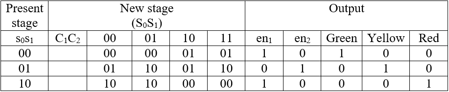
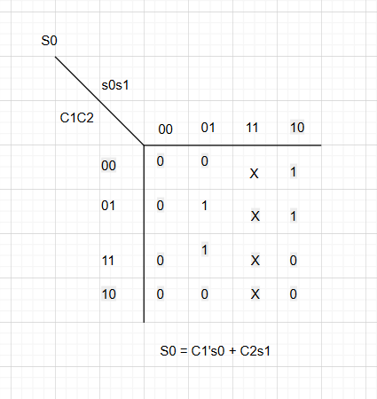
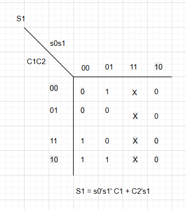
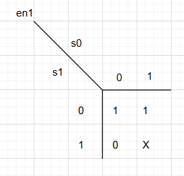
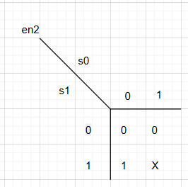
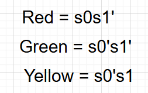

# Design notes

These notes transcribe the controller design from slides 21–24 of the [technical slide excerpts](technical-slides.pdf). They document the intended logic; they are not a new simulation report.

## State and output table

`s0` and `s1` are the current-state bits, in that order. `S0` and `S1` denote the next-state bits. `C1` and `C2` are active-high countdown-completion indications.

| Current state | `C1 C2=00` | `01` | `10` | `11` | `en1` | `en2` | Green | Yellow | Red |
| --- | --- | --- | --- | --- | --- | --- | --- | --- | --- |
| A (`00`) | A (`00`) | A (`00`) | B (`01`) | B (`01`) | 1 | 0 | 1 | 0 | 0 |
| B (`01`) | B (`01`) | C (`10`) | B (`01`) | C (`10`) | 0 | 1 | 0 | 1 | 0 |
| C (`10`) | C (`10`) | C (`10`) | A (`00`) | A (`00`) | 1 | 0 | 0 | 0 | 1 |



The original table defines three legal states. Behavior for encoding `11` is unspecified in that table; the Karnaugh maps use it as a don't-care. Recovery from an illegal state is therefore not claimed.

## Karnaugh simplification

Using `~` for NOT, `&` for AND and `|` for OR, the next-state equations shown in slide 23 are:

```text
S0 = (~C1 & s0) | (C2 & s1)
S1 = (~s0 & ~s1 & C1) | (~C2 & s1)
```

The enable and light-output equations are:

```text
en1    = ~s1
en2    =  s1
Green  = ~s0 & ~s1
Yellow = ~s0 &  s1
Red    =  s0 & ~s1
```

These equations reproduce the table for the three legal state encodings.

| Next `s0` | Next `s1` |
| --- | --- |
|  |  |

| `en1` | `en2` |
| --- | --- |
|  |  |



## Countdown and display path

The presentation describes three 74192 BCD counters: two digits for the green/red branch and one for yellow. The supplied schematic contains 74LS247 display decoders, seven-segment displays, 4013 state storage and logic gates.

At the FSM interface, `C1` is treated as completion of the entire green/red branch, and `C2` as completion of the yellow branch. Slide 21 gives a four-bit zero-detection expression. For the two-digit branch, the full zero condition must account for both BCD digits; this document does not infer a complete two-digit detector from that abbreviated expression.

## Evidence and scope

| Asset or claim | Source |
| --- | --- |
| Individual contribution | Traffic light project bullets in the supplied CV |
| Block diagram | Presentation, page 5 |
| FSM diagram | Presentation, page 21 |
| State-assigned table | Presentation, page 22 |
| Next-state and enable Karnaugh maps | Presentation, pages 23–24 |
| Light-output equations | Presentation, page 24 |
| Full circuit image | Presentation, page 25 |
| Editable circuit project | Original `TrafficLight.pdsprj`, preserved byte-for-byte |

Figures are extracted from the embedded images in the supplied PDF. Original labels, spelling and circuit wiring are preserved. The schematic image comes from the presentation and has not been established as a fresh capture of the attached project file.

The contribution is documented as a gate-level digital logic and Proteus project. The supplied materials contain no Verilog/VHDL source, FPGA implementation results, automated testbench, or new waveform captures.

The public slide PDF includes only original pages 5 and 21–25. Page numbers in this document refer to the original presentation.
